<p align="center">
  
</p>

<p align="center">
  <picture>
    <source media="(prefers-color-scheme: dark)" srcset="docs/readme/wordmark-dark.png">
    
  </picture>
</p>

<p align="center">
  <b>Your Mac's stats, fans, and tools, in the menu bar.</b><br>
  Ten small tools in one native app. Free and open source.
</p>

<p align="center">
  <a href="https://github.com/samhqapp/macpowertoys/releases/latest"><b>Download for Mac</b></a> &nbsp;·&nbsp;
  <a href="https://macpowertoys.samhq.app/">Website</a> &nbsp;·&nbsp;
  <a href="#installation">Installation</a> &nbsp;·&nbsp;
  <a href="https://github.com/samhqapp/macpowertoys/issues">Report a problem</a>
</p>

<p align="center">
  <picture>
    <source media="(prefers-color-scheme: dark)" srcset="docs/readme/bento-dark.webp">
    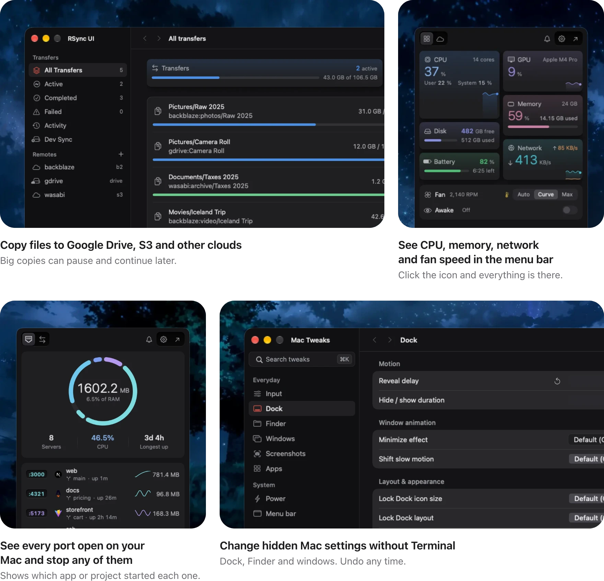
  </picture>
</p>

## Why MacPowerToys

MacPowerToys puts the small tools macOS is missing in one menu bar app.

- **One place.** CPU, memory, network, battery, and fan speed sit in one menu bar panel.
- **Light.** Each tool opens in its own window and does no work while it is closed.
- **Yours.** Turn each tool on or off. Show it in the shared panel, as its own menu bar item, or not at all.
- **Private.** No ads, no tracking. Text recognition runs on your Mac.
- **Native.** A small SwiftUI app, signed and notarized by Apple.

## Tools

| | Tool | What it does |
|:--:|---|---|
|  | **Fan** | Set fan curves that keep your Mac quiet, or run the fans at full speed. |
|  | **Ruler** | Measure anything on screen in pixels, millimeters, or inches. |
|  | **Awake** | Keep the Mac awake for a time, until a time, or while an app runs. |
| 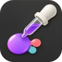 | **Color Picker** | Pick any pixel, copy it in nine formats, and keep colors in projects. |
| 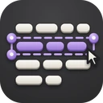 | **Text Extractor** | Select part of the screen and copy its text. |
| 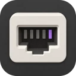 | **Portman** | See your local dev servers and forward ports from an SSH server. |
|  | **RSync UI** | Plan and run rclone copies that pause and resume. |
|  | **Input Devices** | Set scroll direction, speed, and smoothing for mouse and trackpad. |
|  | **Mac Tweaks** | Change hidden Dock, Finder, and window settings. Every original value is kept. |
| 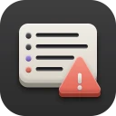 | **Event Viewer** | Read app activity and recent macOS errors. |

## Installation

<details open>
<summary><b>Mac</b> (macOS 26.2 or later)</summary>

<br>

Run this in Terminal:

```sh
brew install --cask samhqapp/tap/macpowertoys
```

Or [download the `.dmg`](https://github.com/samhqapp/macpowertoys/releases/latest), open it, and drag **MacPowerToys** to **Applications**.

Then:

1. Open MacPowerToys. Its icon shows in the menu bar.
2. Turn on the tools you want.
3. Allow access only when a tool asks. Each tool shows a button that opens the right privacy pane.

</details>

<details>
<summary>Permissions and extra parts</summary>

<br>

| Tool | What it needs |
| --- | --- |
| Text Extractor | Screen Recording |
| Input Devices, the Pick Color shortcut | Accessibility |
| Fan control | A signed helper. macOS asks for your password once to install it. |
| RSync UI | [rclone](https://rclone.org/install/): `brew install rclone` |

</details>

## Screenshots

RSync UI, Color Picker, Text Extractor, Mac Tweaks, Input Devices, Event Viewer, and Ruler. Click one to see it full size.

<sub>Every shot uses made-up sample data.</sub>

<p>
<a href="docs/readme/shots/rsync.webp">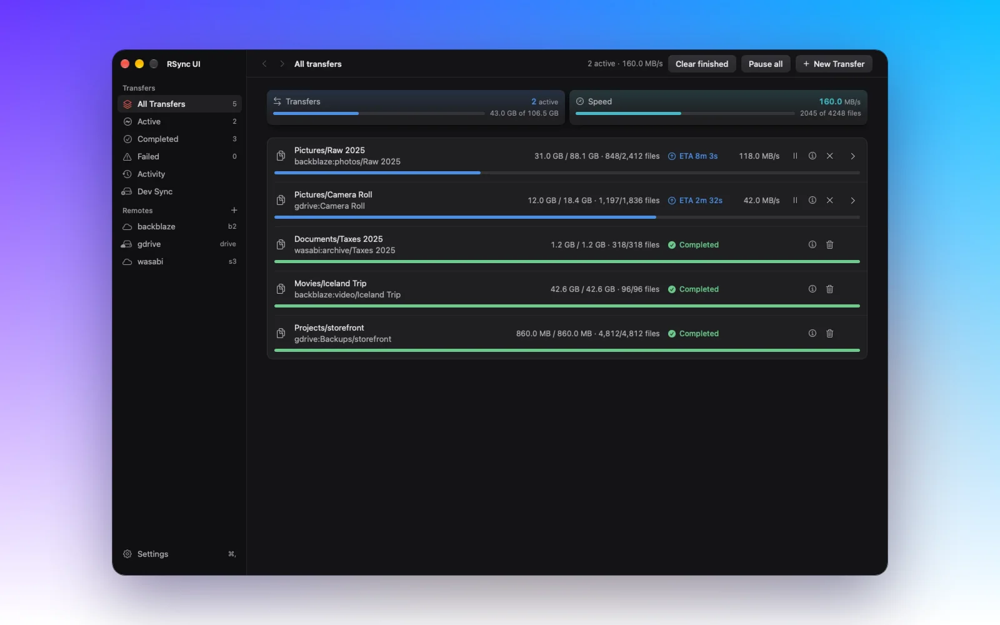</a>
<a href="docs/readme/shots/color-picker.webp">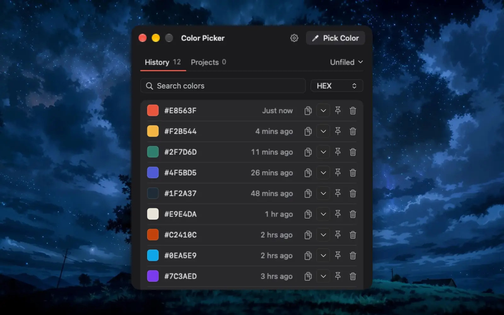</a>
<a href="docs/readme/shots/text-extractor.webp">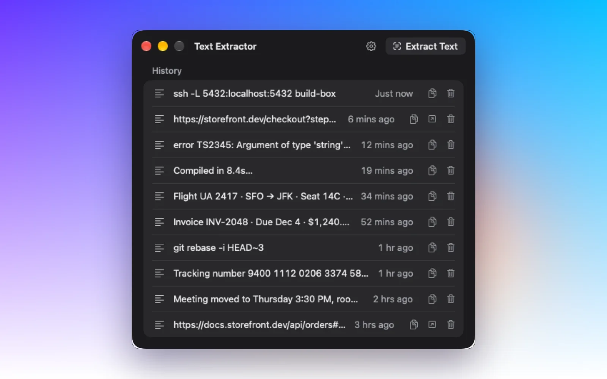</a>
<a href="docs/readme/shots/mac-tweaks.webp">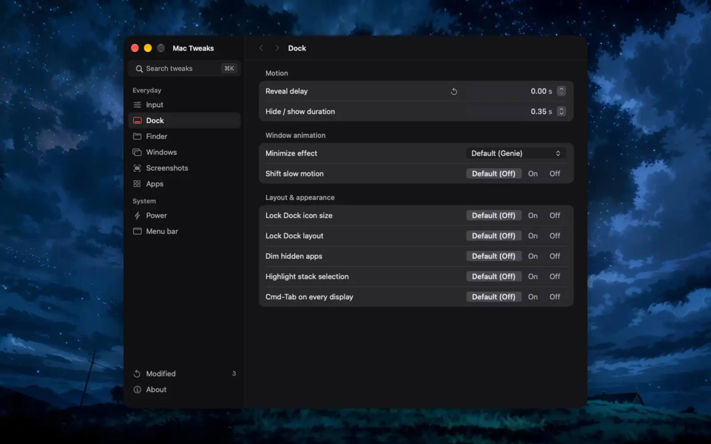</a>
<a href="docs/readme/shots/input-devices.webp">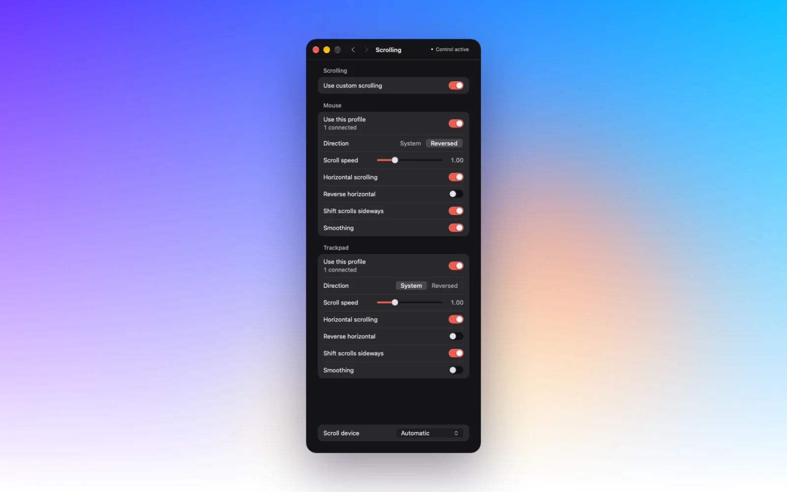</a>
<a href="docs/readme/shots/event-viewer.webp">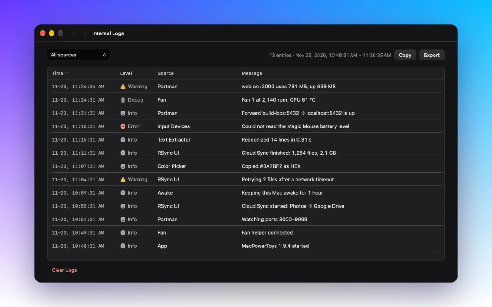</a>
<a href="docs/readme/shots/ruler.webp">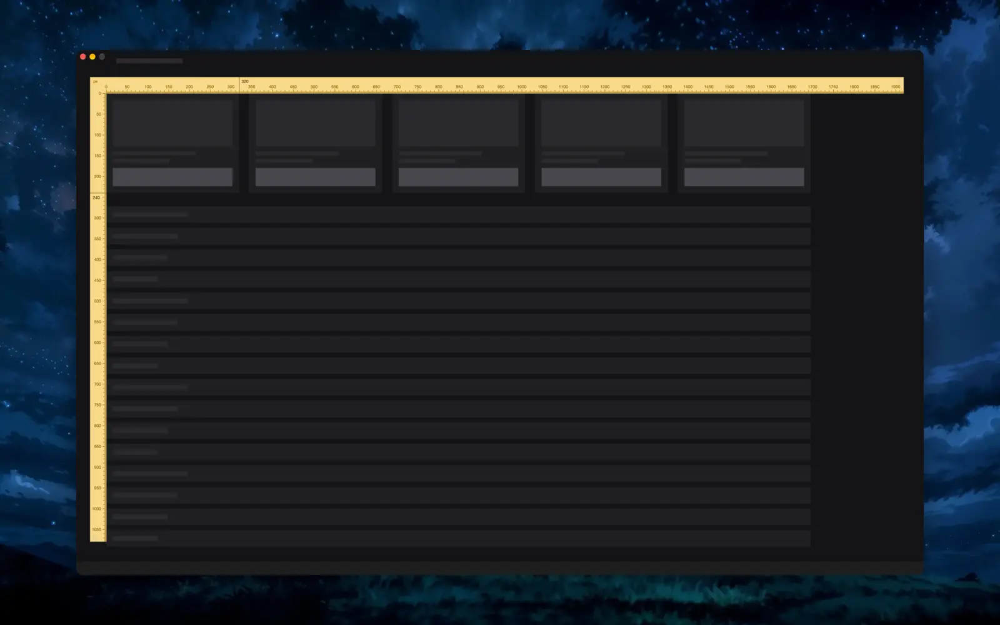</a>
</p>

## Learn more

<details>
<summary><b>Keyboard shortcuts</b></summary>

<br>

| Shortcut | Action |
| --- | --- |
| Command-Shift-3 | Pick a color, in any app |
| Command-Shift-2 | Copy text from part of the screen, in any app |
| Option-Command-P | Open Portman, in any app |
| Command-1 to Command-9 | Open launcher pages: All tools, then the first eight tools |
| Command-O | Open the selected tool |
| Command-F | Search in the current window |
| Command-comma | Open settings for the current window |
| Command-W | Close the window. The app keeps running in the menu bar. |
| Option-Command-Q | Quit MacPowerToys |

Change or turn off the global shortcuts in each tool's settings.

</details>

<details>
<summary><b>Privacy</b></summary>

<br>

MacPowerToys has no accounts, no ads, and no tracking. Text recognition runs on your Mac. Anonymous daily counts (app version, macOS version, and chip) are sent only if you turn them on in Settings. rclone keeps your cloud logins in its own settings file. Optional iCloud settings sync never syncs logins, paths, histories, or logs.

[Privacy Policy](https://macpowertoys.samhq.app/privacy) · [Terms and license](https://macpowertoys.samhq.app/terms) · [Security Policy](SECURITY.md)

</details>

<details>
<summary><b>Limits</b></summary>

<br>

- RSync UI cannot reorder files inside a running folder transfer. A paused file can restart; finished files stay complete.
- Google Drive setup needs your own OAuth client ID.
- Input Devices tells mouse and trackpad apart by event type. macOS does not say which device sent each scroll.
- macOS restores a window's position and display, but not its Space.

</details>

<details>
<summary><b>Build it yourself</b></summary>

<br>

```sh
brew install rclone
git clone https://github.com/samhqapp/macpowertoys.git
cd macpowertoys
make build          # or: make build ADHOC=1 without an Apple Development identity
```

[Development guide](docs/DEVELOPMENT.md) · [Contributing](CONTRIBUTING.md) · [Changelog](CHANGELOG.md) · [Build your own tool](docs/MARKETPLACE_TOOLS.md)

Partition Manager, System Cleaner, Task Manager, and Sam's Network Utilities are separate apps now. Every window uses [OnePlusUI](https://github.com/samhqapp/oneplus-ui), a SwiftUI component package.

</details>

<details>
<summary><b>Credits</b></summary>

<br>

Ruler includes [Free Ruler](https://github.com/pascalpp/FreeRuler) by Pascal Balthrop (MIT, [license](powertoys/FreeRuler/FreeRuler-LICENSE.txt)). The fan reader adapts code from [smctl](https://github.com/leaperone/smctl) (MIT, [license](powertoys/Core/smctl-LICENSE.txt)). RSync UI is a native app for [rclone](https://rclone.org/). The menu bar glyph is adapted from [Lucide](https://lucide.dev) (ISC).

</details>

<br>

<p align="center">
  Open source apps can look this good. If you agree, a star on GitHub helps more people find MacPowerToys.<br>
  <a href="https://github.com/samhqapp/macpowertoys"><b>⭐ Star MacPowerToys on GitHub</b></a>
</p>

## License

MacPowerToys is released under the [MIT license](LICENSE).
